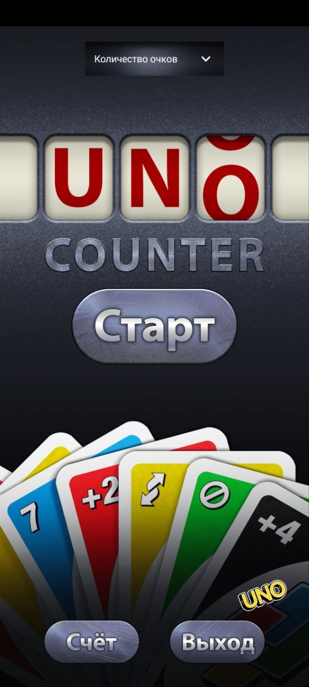
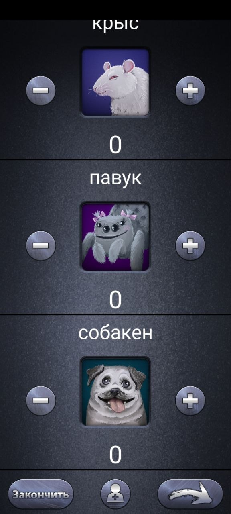
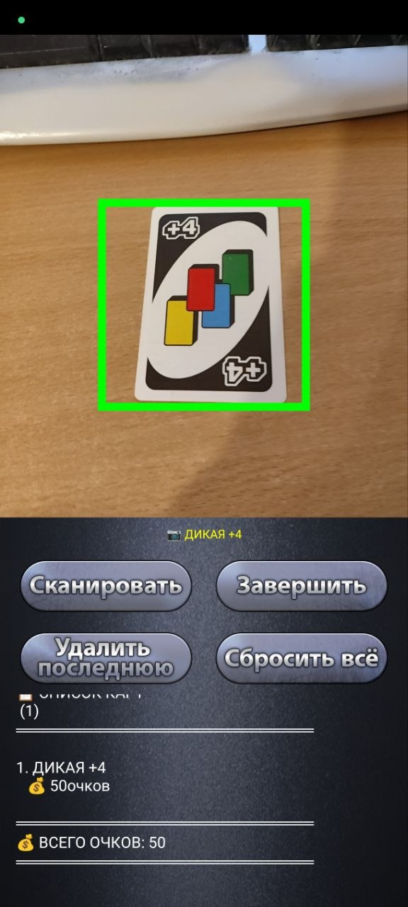

CounterForUno

A simple and convenient score-tracking app for the card game UNO, built with Kotlin using Jetpack Compose. It also incorporates a model for card recognition.

About

CounterForUno helps you keep track of points and wins during UNO games without pen and paper. The app features a clean, game-inspired interface with customizable scoring modes.

Features

- **Two scoring modes:** Points and Wins
- **Persistent settings:** Your selected mode is saved between sessions
- **Camera permission handling:** Requests camera access on first launch (for future features)
- **Game-inspired UI:** Custom backgrounds and buttons styled to match the UNO theme
- **About dialog:** Built-in license viewer (MIT License)

 Screenshots

<table>
  <tr>
    <td></td>
    <td></td>
    <td></td>
  </tr>
</table>
